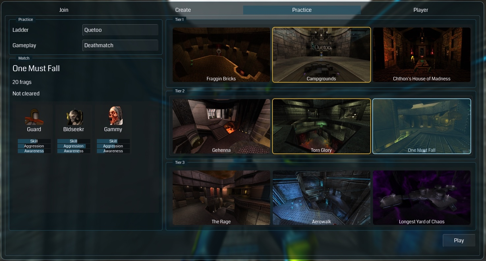
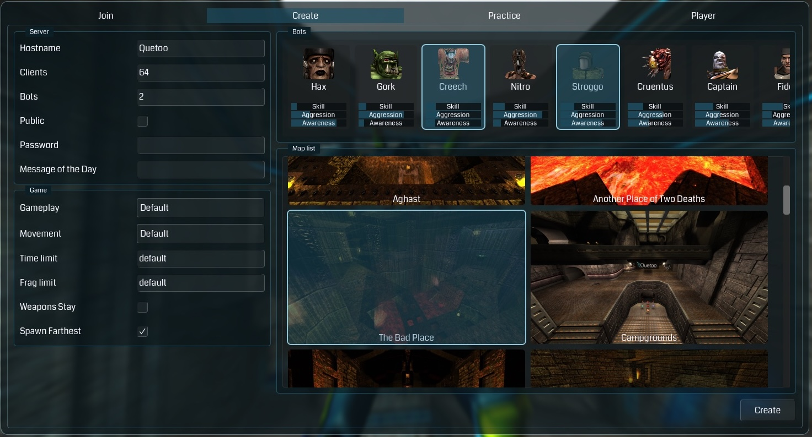
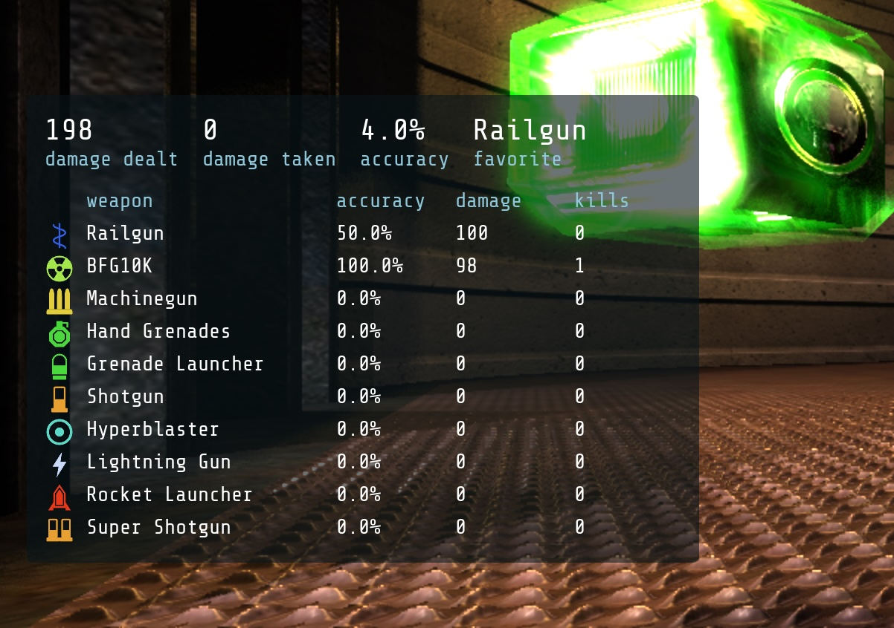
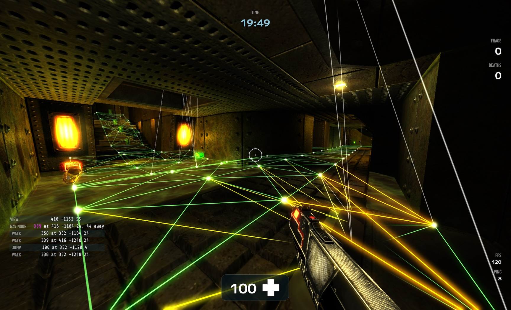

October 19, 2026

# 🤖 Rise of the Bots

Quetoo's bots have just been rewritten from the ground up, and boy are they good. The new system now generates navigation data at map load, for any map, mod and movement type. Bots received an entirely new brain that groks long and short term goals, advanced movement like strafe jumping, and human-like aim. And they power Quetoo's new **Practice** mode, a Quake 3 style single-player campaign that runs from massive free-for-all brawls up to a 1v1 showdown with the **Bastard**.

And what a bastard he is. He times items and strafe jumps to beat you to them. He dodges projectiles and splash damage. He even knows how to spring traps on **The Frag Pipe** and **Claustrophobopolis**. We think you'll agree that he earns his name.

## For players

### Practice mode

Open **Play** and select the **Practice** tab. Choose a ladder, pick a tier, and see what you're made of. Five ladders ship today:

- **Quetoo**: A gauntlet of Quetoo's 9 original deathmatch levels.
- **Quake**: The Quake deathmatch maps, plus _Chthon's House of Madness_.
- **Quake II**: The Quake II deathmatch maps, plus _The Rage_.
- **Instagib**: One shot, one kill, every match, on compact and purpose-built arenas.
- **Duel**: Control the map in 1v1 combat against _Enforcer_, then _Gunner_, then the _Bastard_.

Most ladders open with seven-player free-for-alls, tighten up to four players, and finish 1v1. Every match plays to 20 frags, so they're quick, and every tier is open from the start. Work your way up, or skip straight to the beating.

To clear a map, finish the match with the top score, outright. A tie is a loss. The intermission shows **Victory** or **Defeat**, and you press **1** for the next match, **2** to retry, or **3** to exit. Each ladder keeps its own progress, and except for Instagib, you can play any ladder under the gameplay of your choice, each with its own record of cleared maps.

Practice works in Lithium, too.

### Pick your Bots

The **Create Server** menu now has a bot picker above the map list. Each of the 24 bots on the roster gets a card with its portrait, its name, and bars for its skill, aggression and awareness, sorted from the pushovers up to Bastard. The bots you select always join, and random picks fill out the rest of the bot count.

### Match stats

When a match ends, the intermission shows your stats in a panel beside the scoreboard: damage dealt and taken, accuracy, favorite weapon, and a row for each weapon you used. Your favorite weapon is the one that did the most damage. And yes, a rail through two enemies counts as two hits, so your accuracy can top 100%. We won't tell.

### Smarter bots

**Navigation that builds itself.** The nav mesh is generated at level load from the movement that's active right now, so every mod and every movement mode gets proper bot navigation for free. The mesh knows every class of jump: strafe jumps, water jumps, ladder climbs, you name it.

**A brain with a memory.** Bots run on a new state machine, and they remember a lot more than they used to. They stick to long-term goals while handling short-term distractions and obstacles. Case in point: the red armor on _Claustrophobopolis_. A bot hits the switch, runs halfway around the map, grabs the rocket launcher on the way, and rides the extended plank up to the armor. Nobody scripted that. They worked it out.

**Strafe jumping.** Higher-skilled bots strafe jump on clear, open stretches of their route. Don't be surprised if Bastard races you to the quad.

**Map traps.** Crushers, the Frag Pipe, and friends. When you're standing in a trap's path, a bot that can reach its button will press it, or shoot it if it has to. Prepare to be humiliated 😛

**Smarter combat.** Bots arm themselves before they go hunting. They fight back when caught unarmed, retreat when outgunned or low on health, and dodge projectiles, so lobbing rockets down a hallway isn't a free frag anymore.

**Aim that looks human.** No more flick shots. Bot movement and aim are smooth and human-like, so chasecamming them is actually enjoyable. Each weapon has a ballistics profile, and the bots use it to lead their targets and aim splash weapons at your feet. Don't be surprised when Bastard air-rockets you off the mega health on _The Longest Yard_.

**A roster with personalities.** All 24 bots have their own skill, aggression and awareness, along with their own model and colors. Skill runs from .10 at the bottom of the roster to .99 for Bastard.

## For mappers and server admins

**No more nav authoring.** Bots navigate any map out of the box, and the old `.nav` files are gone. Ship a map, and the bots know how to play it.

**Traps.** Tag a mover with `"ai_hint" "trap"` to let bots spring it. Doors, plats, walls and water all qualify, and bots follow the button through up to four `trigger_relay`s to find it.

**Choose the bots.** A level's `ai` key, in the map list or on worldspawn, names the bots that always join that level. See [Bots](/docs/server-admin/#bots) in the server admin docs.

## For modders

Practice ladders are plain text. A ladder is a `practice-<name>.lst` file in the map list format: a title entity, optionally with a `gameplay` that every match plays, then one entity for each match, with its `tier`, map, `ai` players, and an optional `frag_limit` or `time_limit`. A ladder holds up to three tiers of three maps, with up to six bots a match. Drop one in your game directory and it shows up in the Practice tab. The five that ship are in [quetoo-data](https://github.com/jdolan/quetoo-data/tree/main/target/default).

See you in the arena. 🔫

—jdolan

- **Downloads:** [quetoo.org/downloads](https://quetoo.org/downloads)
- **Discord:** [discord.gg/unb9U4b](https://discord.gg/unb9U4b)
- **GitHub:** [github.com/jdolan/quetoo](https://github.com/jdolan/quetoo)
- **Release notes:** [Quetoo](https://github.com/jdolan/quetoo/releases) · [Quetoo Data](https://github.com/jdolan/quetoo-data/releases)

